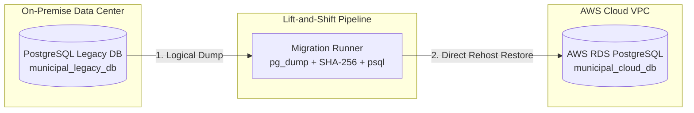
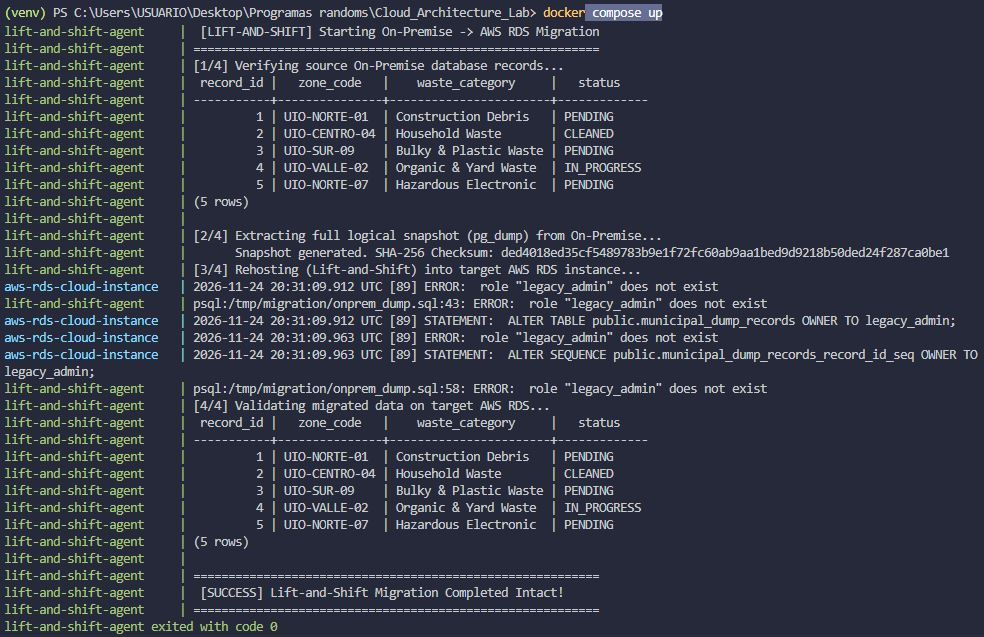

# Branch 04: Lift-and-Shift Migration Strategy (On-Premise to AWS)

## 1. Proposed Solution
This implementation demonstrates a **Lift-and-Shift (Rehosting)** migration pipeline moving an existing On-Premise PostgreSQL workload to an AWS RDS PostgreSQL instance without modifying the database schema or application data model:
- **Source (`onpremise-legacy-db`):** Simulates an on-premise data center server pre-populated with legacy municipal waste records (`onprem-init/seed.sql`).
- **Migration Agent (`migration-runner`):** Automates extraction via `pg_dump`, computes a `SHA-256` integrity checksum, and restores the exact schema and records into the cloud target.
- **Target (`aws-rds-target-db` & `terraform/rds.tf`):** Simulates the target managed AWS RDS instance locally and provides the Terraform definition for provisioning the production AWS RDS database.

## 2. Architecture Diagram



## 3. Execution & Evidence Steps
1. Start the On-Premise source, AWS RDS target, and execute the automated migration runner:
   ```powershell
   docker compose up
   ```
2. Observe the `lift-and-shift-agent` container logs showing:
   - Source table records in `onpremise-legacy-db`
   - Generated `SHA-256` snapshot checksum
   - Target table verification in `aws-rds-target-db`
3. Clean up containers and volumes:
   ```powershell
   docker compose down -v
   ```

## 4. Execution Evidence

### Lift-and-Shift Execution Logs (`pg_dump` -> SHA-256 -> AWS RDS Restore)
