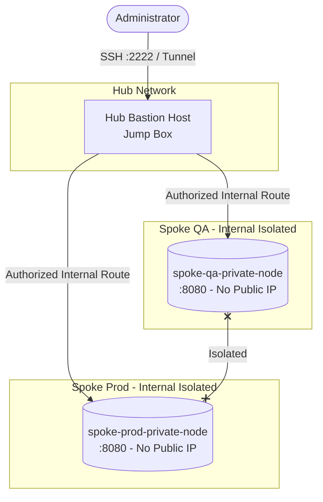
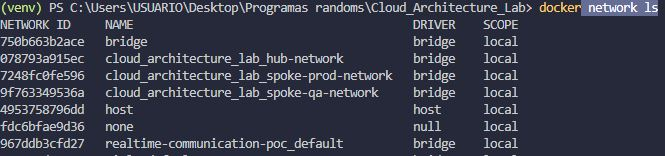
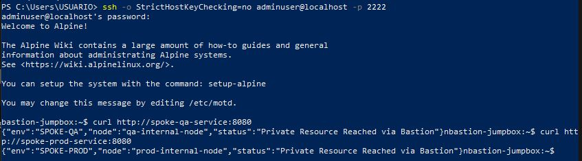

# Branch 03: Hub-and-Spoke Architecture & Bastion Host

## 1. Proposed Solution
This implementation demonstrates centralized network segmentation and secure administrative access:
- **Hub-and-Spoke Topology:** A central **Hub** network hosts shared access controls, while **Spoke QA** and **Spoke Prod** networks are configured as strictly `internal: true` isolated networks with zero direct external exposure and no direct Spoke-to-Spoke communication.
- **Bastion Host (Jump Box):** An SSH-hardened container (`hub-bastion-host` on port `2222`) acts as the sole entry point to inspect private Spoke nodes or establish encrypted SSH port-forwarding tunnels.
- **AWS Ready (`terraform/main.tf`):** Includes declarative Terraform IaC defining an AWS Hub VPC, isolated Spoke VPCs, VPC Peering connections, and an EC2 Bastion Host.

## 2. Architecture Diagram



## 3. Execution & Evidence Steps
1. Build and start the isolated networks and Bastion container:
   ```powershell
   docker compose up --build -d
   ```
2. Verify that Spoke nodes cannot be reached directly from the host (fails as expected), then connect via SSH into the Bastion Host (`password: BastionPass123!`):
   ```powershell
   ssh -o StrictHostKeyChecking=no adminuser@localhost -p 2222
   ```
3. Inside the Bastion shell, query both isolated Spoke nodes and verify Spoke-to-Spoke isolation:
   ```bash
   curl http://spoke-qa-service:8080
   curl http://spoke-prod-service:8080
   exit
   ```
4. Tear down containers:
   ```powershell
   docker compose down
   ```

## 4. Execution Evidence

### Network Topology & SSH Access via Bastion Jump Box


### Reaching Isolated Spoke QA & Prod Nodes Through the Hub
