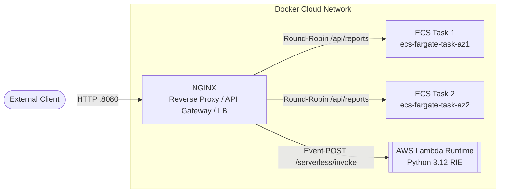
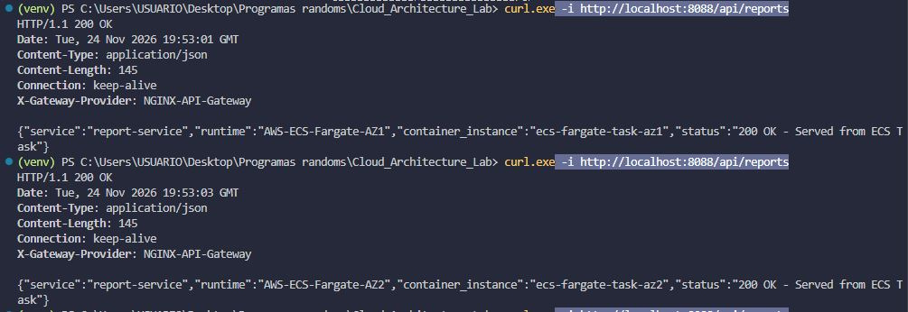
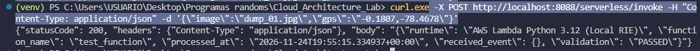

# Branch 02: Serverless (Lambda), Containers (ECS) & API Gateway / Load Balancer

## 1. Proposed Solution
This architecture demonstrates edge traffic routing combined with containerized and serverless compute models:
- **Reverse Proxy, API Gateway & Load Balancer (`NGINX`):** Exposes port `8080` as a single entry point, enforces rate limiting (`5 req/s`), injects gateway headers, and distributes `/api/*` traffic via **Round-Robin** across multiple container replicas.
- **Containers (`Docker / AWS ECS Fargate`):** Two isolated FastAPI container tasks (`ecs-fargate-task-az1` and `az2`) simulating multi-AZ high availability.
- **Serverless (`AWS Lambda Runtime`):** Uses the official `public.ecr.aws/lambda/python:3.12` image running the AWS Lambda Runtime Interface Emulator (RIE) to process event-driven payloads at `/serverless/invoke`.

## 2. Architecture Diagram



## 3. Execution & Evidence Steps
1. Build and start the stack (requires Docker Desktop running):
   ```powershell
   docker compose up --build -d
   ```
2. Test Load Balancing across ECS containers (run multiple times to see `container_instance` alternate between `az1` and `az2`):
   ```powershell
   curl.exe -i http://localhost:8080/api/reports
   ```
3. Test Serverless AWS Lambda invocation through the API Gateway:
   ```powershell
   curl.exe -X POST http://localhost:8080/serverless/invoke -H "Content-Type: application/json" -d '{\"image\":\"dump_01.jpg\",\"gps\":\"-0.1807,-78.4678\"}'
   ```
4. Stop and clean up containers:
   ```powershell
   docker compose down
   ```

## 4. Execution Evidence

### Load Balancer Alternating Between ECS Tasks (`az1` & `az2`)


### Serverless AWS Lambda Invocation via API Gateway
