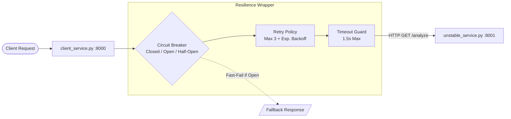
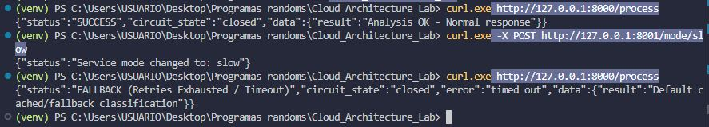
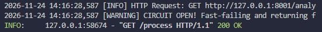
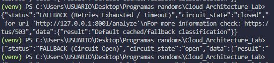

# Branch 01: Resilience Patterns (Circuit Breaker, Retry & Timeout)

## 1. Proposed Solution
This implementation demonstrates how three core cloud resilience patterns work together to protect a microservice (`client_service.py`) when communicating with an unreliable external dependency (`unstable_service.py`):
- **Timeout Pattern (`httpx`):** Aborts requests exceeding `1.5s` to prevent thread exhaustion.
- **Retry Pattern (`tenacity`):** Automatically retries transient failures up to 3 times using exponential backoff.
- **Circuit Breaker (`pybreaker`):** Opens the circuit after 3 consecutive failed operations, fast-failing subsequent requests with a fallback response for `15s` before entering `Half-Open` recovery testing.

## 2. Architecture Diagram



## 3. Execution & Evidence Steps
1. Activate virtual environment and install dependencies:
   ```powershell
   pip install -r requirements.txt
   ```
2. Run unstable target service (Terminal 1):
   ```powershell
   uvicorn unstable_service:app --port 8001
   ```
3. Run resilient client service (Terminal 2):
   ```powershell
   uvicorn client_service:app --port 8000
   ```
4. Test scenarios via Terminal 3 (`curl.exe` in PowerShell):
   - **Normal:** `curl.exe [http://127.0.0.1:8000/process](http://127.0.0.1:8000/process)`
   - **Timeout test:** `curl.exe -X POST [http://127.0.0.1:8001/mode/slow](http://127.0.0.1:8001/mode/slow)` then call `/process`
   - **Retry test:** `curl.exe -X POST [http://127.0.0.1:8001/mode/flaky](http://127.0.0.1:8001/mode/flaky)` then call `/process`
   - **Circuit Breaker Open:** `curl.exe -X POST [http://127.0.0.1:8001/mode/down](http://127.0.0.1:8001/mode/down)` then call `/process` 3 times until `circuit_state` becomes `open`.

## 4. Execution Evidence

### Normal Flow & Timeout Handling


### Retry & Circuit Breaker Open (Fallback)


